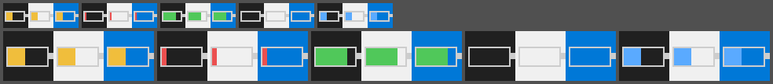

# ATK 鼠标电量托盘工具

[](https://github.com/Techxey/atk-mouse-battery/actions/workflows/build.yml)
[](https://github.com/Techxey/atk-mouse-battery/releases)
[](LICENSE)

一个 **32 KB、单文件、零运行时依赖** 的 Windows 托盘小工具：不用再打开网页驱动，鼠标悬停托盘图标就能看到
2.4G 鼠标的**电量百分比、电压和连接状态**。

A tiny (32 KB) native Windows tray app that reads the battery of **ATK / Compx 2.4G mice** straight from the
HID receiver — no web driver, no .NET/Python runtime, no installer.



> 图标 = 电池格数 + 颜色：绿 ≥60%、黄 20–59%、红 ≤20%、蓝 = 有线/充电中、灰空壳 = 读不到。
> 精确数字、电压、连接状态在**悬停提示**里。

## 特性

- **原生实现**：纯 Win32 + HID，单个 exe（约 32 KB），无 DLL、无框架、无安装包
- **占用极低**：私有内存约 **1.8 MB**，空闲 CPU 约 **0%**，不写服务、不加计划任务
- **不打扰**：只能从托盘读取，鼠标悬停即看；左键立即刷新；右键菜单可退出
- **电量格图标**：按电量比例填充，20% 以下变红并弹一次气泡提醒（可关）
- **连接状态**：区分「已连接」「鼠标关机/超范围」「接收器未插入」「有线/充电中」
- **开机自启**：菜单里一键开关（写 `HKCU\…\Run`，默认关闭）
- **免驱动**：直接解析接收器厂商 HID 通道，不需要 ATK HUB / 网页驱动
- **多语言**：界面为中文；代码与协议说明见下文，便于移植

## 兼容性

| 设备 | VID | PID | 状态 |
|---|---|---|---|
| ATK U2 PLUS（NK 版）2.4G 接收器 | `0x373B` | `0x10C9` | ✅ 已测试 |
| ATK U2 PLUS（NK 版）有线模式 | `0x373B` | `0x126C` | ⚠️ 代码支持，未实测充电状态 |
| 其他 ATK / Compx 2.4G 设备 | `0x373B` | 未知 | 大概率可用，见「扩展支持」 |

系统要求：Windows 10 / 11（x86 或 x64）。本仓库的 Release 构建为 32 位，可在 64 位系统上正常运行。

## 快速开始

1. 从 [Releases](../../releases) 下载 `MouseBattery.exe`（或按下方「构建」自行编译）。
2. 双击运行，托盘出现电池图标（Windows 11 可能把它放进隐藏图标区，可拖到任务栏固定）。
3. **悬停**图标查看电量；**左键**立即刷新；**右键**打开菜单。

## 使用说明

| 操作 | 效果 |
|---|---|
| 悬停图标 | 显示 `ATK 鼠标 · 电量 45% · 3.67V · 已连接(2.4G)` |
| 左键单击 | 立即查询一次（平时每 40 秒自动刷新） |
| 右键 → 立即刷新 | 同上 |
| 右键 → 低电量提醒（20%） | 开关；低于 20% 弹一次气泡，回充到 25% 以上后重置 |
| 右键 → 开机自启 | 开关；勾选后写入当前用户启动项 |
| 右键 → 退出 | 结束程序并移除托盘图标 |

状态文案：

- `已连接(2.4G)` — 接收器在位且查询到电量
- `未连接（鼠标关机或超出范围）` — 接收器在位，但鼠标无响应
- `接收器未插入` — 找不到接收器
- `有线/充电中` — 检测到鼠标以有线模式（`PID 0x126C`）接入

## 构建

### MSYS2 / MinGW-w64（推荐，CI 同款）

```bash
# 安装 mingw-w64 gcc 后
mkdir -p dist
gcc -O2 -s -mwindows -std=gnu99 -DUNICODE -D_UNICODE -finput-charset=UTF-8 \
    -o dist/MouseBattery.exe src/main.c \
    -lsetupapi -lhid -lshell32 -lgdi32 -luser32 -ladvapi32
```

### Dev-C++ 自带 MinGW32（本机开发环境）

```bat
set GCC=D:\Dev-Cpp\MinGW32\bin\gcc.exe
build.bat
```

`build.bat` 默认使用 `PATH` 里的 `gcc`，也可以用 `GCC` 环境变量指定完整路径；产物在 `dist\MouseBattery.exe`。
GCC 4.8.1 到 16.x 均可编译（`src/main.c` 用 C99 编写）。

## 实现原理

接收器没有使用 Windows 标准 HID 电池上报，所以系统设置里看不到电量；程序直接与厂商私有 HID 集合通信：

- HID 厂商集合 `usagePage=0xFF02`，输入/输出报告均 **17 字节**
- 报告 ID `0x08` + **16 字节载荷**；**16 字节之和的低 8 位必须等于 `0x4D`**（末字节为校验）
- 查询电量：载荷 `[0]=0x04`，其余为 0，末字节 `0x49`
- 响应解析：`[0]=0x04`；`[5]` = 电量 %；`[7..8]` = 电压 mV（大端，`0x0E67` = 3687 mV）

详细报文示例与抓包记录见 [docs/PROTOCOL.md](docs/PROTOCOL.md)。

## 自检命令

```bat
MouseBattery.exe --probe        :: 读一次电量，结果写入 %TEMP%\atk-probe.txt（正常退出码 0）
MouseBattery.exe --dump-icons   :: 导出 16/32px 图标 BMP 到当前目录，检查渲染
```

`--probe` 可在不创建托盘的情况下验证协议，适合排查"读不到电量"。

## 扩展支持其他鼠标

`src/main.c` 顶部集中了设备与协议常量：

```c
#define VID_ATK       0x373B   /* 厂商 ID */
#define PID_DONGLE    0x10C9   /* 2.4G 接收器 */
#define PID_WIRED     0x126C   /* 有线模式 */
#define CMD_PAGE      0xFF02   /* 命令通道 usage page */
```

若新的 ATK/Compx 设备仅 PID 不同，改 `PID_*` 即可；若协议不同（不同的 usage page / 帧格式 / 校验），
需要按 `docs/PROTOCOL.md` 里的方法抓一次报文再适配。

## 已知限制

- 仅支持 ATK/Compx（`VID 0x373B`）这一代私有协议；罗技、雷蛇等使用别的协议，不适用。
- "有线/充电中"依据"有线设备是否在线"判断，未解析电池充电标志位，充电显示可能不精确。
- 电量精度由鼠标固件决定（1% 档），不做平滑或电压换算。
- 每次查询会使接收器/鼠标无线链路进行一次小交互；默认 40 秒一次，对续航影响可忽略。

## 致谢

- 协议格式参考了开源项目 [noosxe/atk-tool](https://github.com/noosxe/atk-tool)（MIT），本项目为独立的
  C 语言 Win32 实现。
- 感谢 ATK / Compx 的 2.4G HID 方案让这类小工具成为可能。

本项目与 ATK、Compx 官方无关联，未使用其商标或私有代码。

## 免责声明

本软件按"现状"提供，不附带任何担保。使用前请自行确认设备与协议兼容性；因使用本软件造成的设备异常、
数据丢失或其他损失，作者不承担责任。切勿在未知设备上盲目写入非查询类报文。

## License

[MIT](LICENSE)
